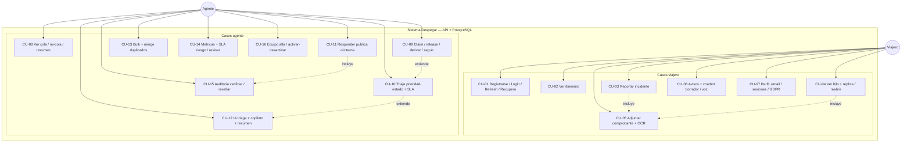

# Casos de uso — Despegar Grupo 8

> Alcance: qué puede hacer cada rol contra el sistema. Diagrama visual: `caso-uso.drawio` (abrir en app.diagrams.net). Detalle técnico: `api.md`. Visión general: `../DOC_PROYECTO.md`.

## 1. Actores

| Actor | Quién es | Notas |
|---|---|---|
| Viajero | Cliente con reservas | Solo ve y toca lo suyo (ownership, 403 si recurso ajeno). Registro público solo rol `viajero` |
| Agente | Empleado de soporte | Sin registro público (alta por equipo `POST /admin/agentes`). Ve toda la cola |
| Sistema | API + PostgreSQL + proveedores | Verifica JWT en cada pedido, guarda auditoría con hash, notifica. Proveedores (tesseract/Whisper/FCM/WhatsApp) opcionales |

## 2. Diagrama (texto)

## 3. Fichas por caso de uso

| ID | Caso de uso | Actor | Endpoint(s) real(es) | Resultado |
|---|---|---|---|---|
| CU-01 | Registrarse / login / refresh / recupero | Viajero, Agente (login) | `POST /register`, `POST /login`, `POST /refresh`, `POST /logout`, `POST /password/solicitar`, `POST /password/restablecer`, `POST /email/solicitar`, `POST /email/verificar` | Par `{user,token,refresh_token}` JWT 8h + refresh 30d rotado |
| CU-02 | Ver itinerario | Viajero | `GET /itinerario` | Solo reservas propias |
| CU-03 | Reportar incidente | Viajero | `POST /incidentes` (+`Idempotency-Key`) | Estado Abierto, `prioridad` NULL + sugerida IA, evento `creado` |
| CU-04 | Ver hilo + réplica / reabrir | Viajero | `GET /incidentes/:id`, `GET /incidentes/:id/respuestas`, `POST /incidentes/:id/respuestas`, `POST /incidentes/:id/reabrir` | Réplica reabre Resuelto; viajero solo ve hilo público |
| CU-05 | Adjuntar comprobante + OCR | Viajero, Agente (dueño/agente) | `GET+POST /incidentes/:id/adjuntos`, `POST /incidentes/:id/adjuntos/:adj/ocr`, `GET /incidentes/:id/resumen?lang=` | Base64 5MB jpg/png/pdf; OCR autovincula reserva |
| CU-06 | Avisos + chatbot / voz | Viajero (+agente solo avisos) | `GET /notificaciones`, `POST /notificaciones/:id/leer`, `POST /notificaciones/leer-todas`, `POST /chatbot/borrador`, `POST /stt/transcribir`, `GET /stream` | Polling/SSE cada 30s; borrador sugiere tipo/título/faltantes |
| CU-07 | Perfil: email / sesiones / GDPR | Viajero, Agente | `GET /me`, `DELETE /me` | Verificación email, cierre una/todas, borrado anonimiza |
| CU-08 | Ver cola / mi-cola / resumen | Agente | `GET /admin/incidentes`, `GET /admin/mi-cola`, `GET /admin/incidentes/resumen` | `orden=urgencia`: vencidos SLA, sin triar, Crítica/Alta/Baja |
| CU-09 | Claim / release / derivar / seguir | Agente | `POST /admin/incidentes/:id/claim`, `.../release`, `.../derivar`, `POST+DELETE .../seguir` | Transaccional `FOR UPDATE`; 409 si tomado por otro |
| CU-10 | Triaje prioridad-estado + SLA | Agente | `GET+PUT /admin/incidentes/:id` | Fija `triado_por/at` + `sla_vence_at` (4/24/72h); Resuelto exige prioridad |
| CU-11 | Responder pública o interna | Agente | `GET+POST /admin/incidentes/:id/respuestas` | Atómica vía `crear_respuesta()`; interna invisible al viajero |
| CU-12 | IA triage + copiloto + resumen | Agente | `GET /admin/incidentes/:id/ia`, `POST /admin/incidentes/:id/copiloto` | Score 0-1 + motivo; copiloto sugiere (no envía) |
| CU-13 | Bulk + merge duplicados | Agente | `POST /admin/incidentes/bulk`, `POST /admin/incidentes/:id/merge` | Bulk max 50 `{ok,errores,total}`; merge pasa a Duplicado |
| CU-14 | Métricas + SLA riesgo / revisar | Agente | `GET /admin/metricas`, `GET /admin/metricas.csv`, `GET /admin/sla/riesgo`, `POST /admin/sla/revisar` | MTTR/vencidos/por-agente; riesgo = vencen <6h |
| CU-15 | Auditoría verificar / resellar | Agente | `GET /admin/incidentes/:id/historial`, `GET /admin/incidentes/:id/auditoria`, `POST /admin/incidentes/:id/auditoria/resellar` | Hash encadenado; resellar tolera legacy (prev null) |
| CU-16 | Equipo alta / activar-desactivar | Agente | `GET+POST /admin/agentes`, `PUT /admin/agentes/:id/estado` | No auto-desactivar; desactiva revoca sesiones |

## 4. Reglas transversales

- Todo caso (salvo register/login/health/refresh/password) exige `Authorization: Bearer <jwt>`; 401 sin/inválido/expirado, 403 rol o recurso ajeno.
- Viajero nunca toca `/admin/*` (403). Notas internas invisibles al viajero.
- Cada cambio de caso deja evento de auditoría con hash (actor + IP/UA).
- Errores UI por situación (cargando/vacío/error con reintentar/éxito/confirmación), sin datos sensibles en logs.
